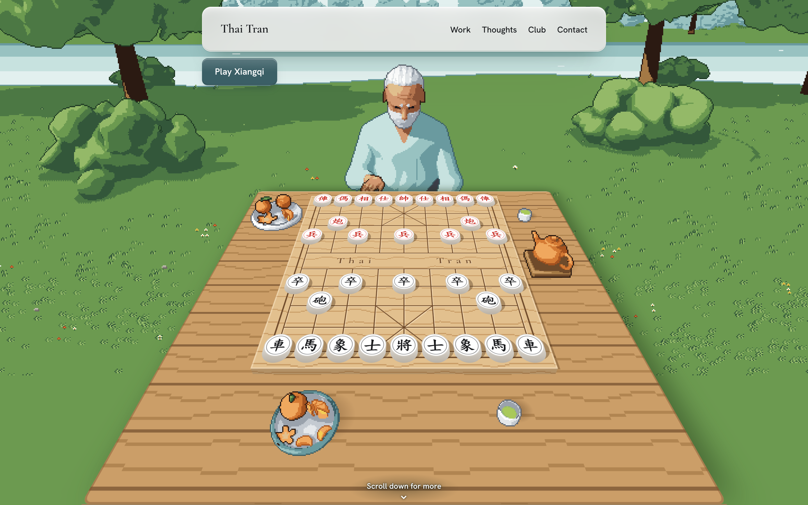
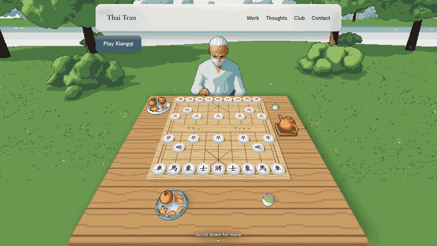

# thaimtl.github.io

My portfolio, built as a game of xiangqi (Chinese chess) against my grandfather.
Live at [thaimtl.github.io](https://thaimtl.github.io).



## How it works

Scroll and the camera moves between the pieces on the board.
Each piece opens one part of my story.



- Hover a piece to see where it can move.
- Hover the tea or the clementines for a small card.
- Press Play Xiangqi (768px and wider) to play Black against a bot.

## Run it

There is no build step and no dependency.

```bash
python3 -m http.server 4175
```

Then open `http://localhost:4175/`.

## Check it

```bash
node tools/check-game.mjs site.js
node tools/check-bot.mjs
```

## What is where

- `index.html`, `site.css`, `site.js`: the page.
- `bot.js`: the xiangqi bot for play mode.
- `tools/scene/`: the code that draws the pixel art in `img/`.
- `cal-hacks-13/`: the Silent Voice writeup.
